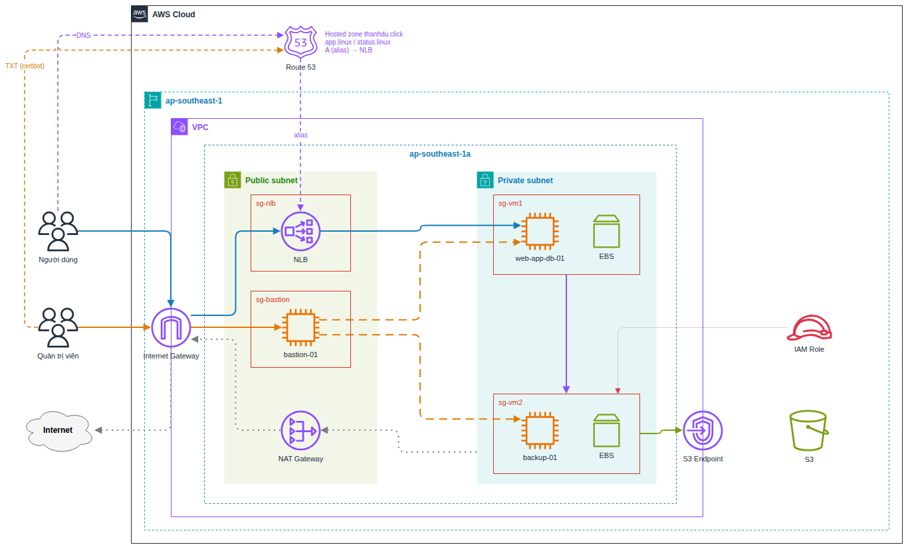

# Giải thích hạ tầng AWS — đọc hiểu từng tầng

> Tài liệu **giải thích** cho cả nhóm: hạ tầng gồm những gì, nằm ở đâu, gói tin đi thế nào.
> Các **quyết định** và **bảng rule chi tiết** (SG, NACL, route table) nằm trong [`architecture.md`](architecture.md) — tài liệu này không lặp lại, chỉ trỏ tới.
> Chủ sở hữu: Dự (Hạ tầng).

---

## 1. Cây hạ tầng

Đi từ ngoài vào trong, mỗi tầng ghi module Terraform tạo ra nó:

```
AWS Account
└── Region ap-southeast-1 (Singapore)
    ├── [toàn cục]  IAM role/profile            ← modules/iam
    ├── [toàn cục]  Route 53 zone thanhdu.click ← có sẵn khi mua domain; bản ghi: modules/route53
    ├── [region]    S3 backup bucket            ← modules/s3
    └── VPC 10.0.0.0/16                         ← modules/vpc
        ├── Internet Gateway, Route tables, S3 Endpoint
        └── AZ ap-southeast-1a
            ├── Public subnet 10.0.1.0/24       ← NACL public   (modules/nacl)
            │   ├── NAT Gateway
            │   ├── NLB                         ← modules/nlb
            │   └── bastion-01                  ← modules/ec2
            └── Private subnet 10.0.2.0/24      ← NACL private  (modules/nacl)
                ├── web-app-db-01 (VM1)         ← modules/ec2
                └── backup-01 (VM2)             ← modules/ec2
        (SG gắn vào từng máy/NLB)               ← modules/security-group
```



> Nguồn sơ đồ: [`images/aws-architecture.drawio`](images/aws-architecture.drawio) (mở bằng draw.io / diagrams.net).

IAM và S3 thuộc môi trường **`shared`** (sống lâu); mọi thứ trong VPC thuộc môi trường **`lab`** (dựng/huỷ hằng ngày). Vì vậy `terraform destroy` lab không làm mất backup.

---

## 2. Giải thích từng tầng

### Tầng 0 — Account & toàn cục

- **`modules/iam`** — IAM là dịch vụ **toàn cục**, không thuộc region/VPC.
  - Role `linux-project-backup-role`: chỉ dịch vụ EC2 được "đóng vai".
  - Policy: `Put/Get/DeleteObject` + `ListBucket` trên **đúng 1 bucket backup** (quyền tối thiểu).
  - Instance profile: "vỏ bọc" để gắn role vào EC2 — **chỉ VM2** được gắn. VM2 gọi `aws s3 sync` không cần lưu access key (credential tạm lấy qua IMDSv2).
- **Route 53** — DNS cũng là dịch vụ **toàn cục**. Hosted zone `thanhdu.click` do AWS tự tạo khi mua domain, Terraform **chỉ đọc** nó; module `route53` (môi trường `lab`) thêm 2 bản ghi trỏ vào NLB. Chi tiết: [mục 7](#7-dns--route-53-tên-miền-trỏ-vào-nlb).
- **`bootstrap/`** (chạy 1 lần, không phải module) — bucket chứa tfstate: versioning, mã hoá, chặn public, `prevent_destroy`.

### Tầng 1 — Region

Region = khu vực địa lý gồm nhiều trung tâm dữ liệu. Chọn `ap-southeast-1` vì gần Việt Nam (biến `aws_region`).

- **`modules/s3`** — bucket là tài nguyên **theo region** nhưng tên phải **duy nhất toàn cầu** → `linux-project-backup-<account_id>`.
  - Versioning, mã hoá AES256, chặn mọi truy cập public.
  - Lifecycle: xoá backup sau 30 ngày, bản cũ sau 7 ngày, upload dở dang sau 1 ngày.

### Tầng 2 — VPC (`modules/vpc`)

VPC = **mạng riêng ảo** trong region, dải `10.0.0.0/16`. Một VPC trải được nhiều AZ.

| Thành phần | Vai trò |
|---|---|
| `aws_vpc` | Mạng chính; bật DNS nội bộ |
| `aws_internet_gateway` | Cổng nối VPC ↔ Internet (xem [mục 4](#4-internet-gateway-dịch-ip-11)) |
| `aws_route_table.public` | `0.0.0.0/0 → IGW` |
| `aws_route_table.private` | `0.0.0.0/0 → NAT` (chỉ khi `enable_nat = true`) |
| `aws_vpc_endpoint.s3` | Gateway Endpoint: tới S3 bằng đường nội bộ AWS, không cần NAT, miễn phí |
| `aws_default_security_group` | Khoá SG mặc định (không rule nào) |

> Route table chỉ quyết định **gói tin đi đường nào**, không quyết định **ai được phép** — việc đó của NACL và SG.

### Tầng 3 — Availability Zone

AZ = một (cụm) trung tâm dữ liệu độc lập trong region. Hệ thống dùng **1 AZ** (`ap-southeast-1a`) — không HA, có chủ đích (D2). AZ không phải resource riêng mà là **thuộc tính** của subnet và ổ EBS. Ổ EBS **phải cùng AZ với máy** mới gắn được.

### Tầng 4 — Subnet

Subnet = một mảnh của VPC, **nằm gọn trong 1 AZ**.

| Subnet | CIDR | Vì sao public/private |
|---|---|---|
| Public | `10.0.1.0/24` | Route table có đường tới **IGW** → máy có IP public ra/vào Internet được |
| Private | `10.0.2.0/24` | Không có đường tới IGW → chỉ ra ngoài qua NAT, từ ngoài **không** vào thẳng được |

Hai subnet tự thấy nhau nhờ route `local` AWS tạo sẵn.

### Tầng 5 — NACL, tường lửa cấp subnet (`modules/nacl`)

- Lọc ở **ranh giới subnet**; **stateless** (phải mở cả chiều về — dải cổng tạm 1024–65535); có ALLOW và DENY, xét theo số thứ tự.
- **Không lọc** traffic giữa 2 máy cùng subnet (vd rsync VM1 → VM2).
- Rule SSH đánh số 120–129 → `admin_cidrs` tối đa 10 CIDR — đường của Ansible + dự phòng; cả nhóm đi qua VPN.
- Rule 150: UDP 51820 vào Bastion cho VPN WireGuard, kèm rule ra UDP 1024–65535 cho gói trả lời.
- Bảng rule: [`architecture.md` § 6.3](architecture.md#63-network-acl).

### Tầng 6 — NLB (`modules/nlb`)

Network Load Balancer ở public subnet — cửa vào **duy nhất** cho người dùng web.
- Listener TCP 80, 443 → target group (chỉ VM1) + health check (80: TCP; 443: HTTPS `/health`).
- **TCP passthrough**: không giải mã TLS (Nginx làm), giữ IP thật của client.
- Gắn `sg-nlb`; bật/tắt bằng `enable_nlb`.

### Tầng 7 — Security Group, tường lửa cấp máy (`modules/security-group`)

- Gắn vào **từng máy/NLB**; **stateful**; chỉ ALLOW; tham chiếu được **SG khác** làm nguồn/đích.

```
Internet ──80/443──► sg-nlb ──80/443──► sg-vm1 ◄──443── sg-vm2
Nhóm ──UDP 51820──► sg-bastion ──22──► sg-vm1 ──22──► sg-vm2 (rsync)
   (SSH đi trong VPN)
                              └──22──► sg-vm2
```

- Cổng 5000 (Flask) và 5432 (PostgreSQL) **không có trong SG nào** — chỉ nghe `127.0.0.1`.
- Bảng rule: [`architecture.md` § 6.2](architecture.md#62-security-group).

### Tầng 8 — Máy chủ (`modules/ec2`)

Một module, **gọi 3 lần**:

| | bastion-01 | web-app-db-01 (VM1) | backup-01 (VM2) |
|---|---|---|---|
| Subnet / IP | public / `10.0.1.10` | private / `10.0.2.10` | private / `10.0.2.20` |
| Loại | t3.micro | t3.small | t3.micro |
| Elastic IP | ✅ | — | — |
| EBS dữ liệu | — | 10 GB → `/data` | 20 GB → `/backup` |
| IAM profile | — | — | ✅ (ghi S3) |

- AMI Ubuntu 22.04 mới nhất của Canonical; `ignore_changes = [ami]` để AMI mới không tự thay máy (muốn nâng: `terraform apply -replace=module.<tên>.aws_instance.this`).
- Root 8 GB mã hoá, bắt buộc **IMDSv2**.
- Trên t3, ổ `/dev/xvdf` hiện ra là `/dev/nvme1n1` → Ansible mount theo `UUID=`.

### Tầng 9 — Trong hệ điều hành (ngoài Terraform)

Terraform dừng ở "có máy, có mạng". Tiếp theo: **Ansible** (Nginx, Flask, PostgreSQL, UFW, fail2ban, mount ổ — đọc `ansible/inventory/hosts.ini` do `inventory.tf` sinh ra) và **Bash toolkit** (vận hành hằng ngày).

### Các module ghép với nhau

```
environments/shared/main.tf          environments/lab/main.tf
  1. s3  ─► bucket_arn ─┐              (đọc shared qua terraform_remote_state)
  2. iam ◄──────────────┘              1. vpc ─► vpc_id, subnet_id
       └─► instance_profile ─────┐     2. nacl ◄─ subnet_id
                                 │     3. security_group ◄─ vpc_id
                                 │     4-6. ec2 ×3 ◄─ subnet_id, sg_id
                                 └──────────► (VM2 nhận instance profile)
                                       7. nlb ◄─ subnet_id, sg_nlb_id, vm1_id
                                       8. route53 ◄─ nlb_dns_name, nlb_zone_id
                                          (+ zone_id từ data source)
                                       inventory.tf ◄─ IP các máy, tên miền
```

Output module trước là input module sau; Terraform tự suy ra thứ tự tạo.

---

## 3. Ba "cửa" của hệ thống: NLB, Bastion, NAT

VM1/VM2 ở private subnet, **không có IP public** → bị cô lập cả 2 chiều. Ba thành phần ở public subnet mở đúng những cửa cần thiết:

```
                    Internet
        ┌──────────────┼──────────────┐
   (web vào)       (SSH vào)      (VM tự ra)
        ▼              ▼              ▲
      NLB          Bastion          NAT          ← cả ba ở public subnet
        │              │              │
        ▼              ▼              │
      VM1         VM1 / VM2      VM1 / VM2       ← private subnet
```

| | Ai mở kết nối trước? | Chiều | Dùng cho |
|---|---|---|---|
| **NLB** | Người bên ngoài | Ngoài → trong | Người dùng truy cập web (chỉ 80/443 tới VM1) |
| **Bastion** | Nhóm quản trị | Ngoài → trong | VPN WireGuard (UDP 51820) → SSH, ProxyJump vào VM1/VM2; SSH thẳng từ `admin_cidrs` cho Ansible và dự phòng |
| **NAT Gateway** | Máy bên trong | Trong → ngoài | `apt`, `pip`, mail cảnh báo — **cấm** chiều vào |

### NAT đặt ở public subnet, nhưng phục vụ private subnet

NAT phải tự ra được Internet nên cần **IP public (Elastic IP)** + **đường tới IGW** — chỉ public subnet có. Private subnet dùng NAT qua **route table**:

```
Private subnet (VM1, VM2)
   │  rt-private:  0.0.0.0/0 → NAT Gateway
   ▼
Public subnet  (NAT Gateway)
   │  rt-public:   0.0.0.0/0 → Internet Gateway
   ▼
Internet
```

### NAT và NLB độc lập với nhau

Response của web **không đi qua NAT** — kết nối mở qua NLB thì trả lời về qua NLB. NAT chỉ lo kết nối **do VM tự mở**.

| `enable_nat` | `enable_nlb` | Web | apt / Ansible | Mail cảnh báo | Backup S3 |
|---|---|---|---|---|---|
| false | false | ❌ | ❌ | ❌ | ✅ (qua S3 Endpoint) |
| true | false | ❌ | ✅ | ✅ | ✅ |
| false | true | ✅ | ❌ | ❌ | ✅ |
| **true** | **true** | ✅ | ✅ | ✅ | ✅ ← **lúc demo** |

SSH quản trị không cần cả hai — đi qua Bastion (Elastic IP riêng).

---

## 4. Internet Gateway dịch IP 1:1

Trong VPC, **không máy nào thực sự cầm IP public** — card mạng chỉ có IP private; AWS chỉ ghi nhận "IP public X thuộc về IP private Y". Kiểm chứng trên bastion:

```bash
ip addr show                              # chỉ thấy 10.0.1.10
curl -s https://checkip.amazonaws.com     # ra Elastic IP
```

IGW làm **NAT 1:1** khi gói tin đi qua:

```
Vào:  1.2.3.4 → 54.1.1.1 (public)   ──IGW──►  1.2.3.4 → 10.0.1.50 (private)
Ra:   10.0.1.50 → 1.2.3.4           ──IGW──►  54.1.1.1 → 1.2.3.4
```

| | Internet Gateway | NAT Gateway |
|---|---|---|
| Kiểu dịch | **1:1** — 1 IP private ↔ 1 IP public cố định | **Nhiều : 1** — cả subnet chung 1 IP public, phân biệt bằng cổng |
| Máy cần IP public? | Có | Không |
| Từ ngoài gọi vào được? | ✅ | ❌ (chỉ nhận trả lời) |
| Dùng cho | Bastion, NLB, và chính NAT Gateway | VM1, VM2 |

Luồng `apt` của VM1 bị dịch **2 lần**: `10.0.2.10 ──NAT GW──► IP private của NAT ──IGW──► Elastic IP của NAT`.

---

## 5. Hop-by-hop: một request web từ Internet

Người dùng `1.2.3.4` chạy `curl https://app.linux.thanhdu.click/items` (chưa có domain: `curl -k -H "Host: app.lab.local" https://<nlb-dns>/items`).

### Chiều vào

| Hop | Trạm | Gói tin / kiểm tra | Kết quả |
|---|---|---|---|
| 0 | DNS | `app.linux.thanhdu.click` → Route 53 trả thẳng IP public NLB `54.1.1.1` (bản ghi alias, [mục 7](#7-dns--route-53-tên-miền-trỏ-vào-nlb)). Gói: `1.2.3.4:51234 → 54.1.1.1:443` | |
| 1 | IGW | Dịch 1:1 → `1.2.3.4:51234 → 10.0.1.50:443` | |
| 2 | 🧱 NACL public (vào) | Rule 110: TCP 443 từ `0.0.0.0/0` | ✅ |
| 3 | 🛡️ sg-nlb (vào) | `nlb_in_https`: 443 từ `0.0.0.0/0` | ✅ |
| 4 | NLB | Listener 443 → `tg-https` → VM1 (healthy). Passthrough, **giữ IP khách**: `1.2.3.4:51234 → 10.0.2.10:443` | |
| 5 | 🛡️ sg-nlb (ra) | `nlb_out_https_to_vm1`: 443 tới `sg-vm1` | ✅ |
| 6 | 🧱 NACL public (ra) | Rule 110: TCP 443 | ✅ |
| 7 | 🧱 NACL private (vào) | Rule 110: TCP 443 từ `0.0.0.0/0` — **bắt buộc**, vì nguồn là IP khách chứ không phải NLB | ✅ |
| 8 | 🛡️ sg-vm1 (vào) | `vm1_in_https_nlb`: 443 từ `sg-nlb` — **lớp chặn chính**, ai không qua NLB đều bị chặn | ✅ |
| 9 | 🔥 UFW | allow 443/tcp | ✅ |
| 10 | Nginx `:443` | Bắt tay TLS (cert Let's Encrypt), `Host: app.linux.thanhdu.click` → vhost → `proxy_pass 127.0.0.1:5000` | |
| 11 | Flask `127.0.0.1:5000` | Loopback — không qua SG/NACL/UFW | |
| 12 | PostgreSQL `127.0.0.1:5432` | Loopback — từ ngoài không thể chạm tới | |

### Chiều về: `10.0.2.10:443 → 1.2.3.4:51234`

| Hop | Trạm | Kiểm tra | Kết quả |
|---|---|---|---|
| R1 | UFW | Stateful | ✅ tự cho về |
| R2 | sg-vm1 (ra) | Stateful | ✅ không cần rule |
| R3 | NACL private (ra) | **Stateless** — cổng đích 51234 → rule 130 (1024–65535) | ✅ |
| R4 | NACL public (vào) | Rule 140 (cổng tạm) | ✅ |
| R5 | NLB | Nhận lại kết nối của nó, chuyển về khách | ✅ |
| R6 | NACL public (ra) | Rule 140 (cổng tạm) | ✅ |
| R7 | IGW | Dịch `10.0.1.50 → 54.1.1.1` → Internet | |

**Tổng cộng: 4 lần qua NACL, 3 lần qua SG, 1 lần qua UFW** — thiếu một rule bất kỳ là request timeout. NACL cần rule cổng tạm vì nó không nhớ kết nối; SG và UFW stateful nên không cần.

---

## 6. Vì sao NLB mà không phải ALB (D4)

| | **NLB** — tầng 4 | **ALB** — tầng 7 |
|---|---|---|
| Thấy gì | IP + cổng TCP | HTTP (URL, header, cookie) |
| TLS | Passthrough — chuyển nguyên gói mã hoá | Bắt buộc giải mã tại ALB |

Lý do chọn NLB:
1. **ALB bắt buộc ≥ 2 subnet ở 2 AZ** — hệ thống chỉ có 1 AZ (D2). NLB chạy với 1 subnet.
2. **Đề yêu cầu Nginx làm TLS + 301** (mục 6). NLB passthrough để Nginx tự giải mã; ALB thì TLS làm ở ALB (cert trên ACM), phần Nginx thành thừa.
3. **Giữ IP thật của client** — fail2ban và log cần IP thật. Sau ALB, Nginx thấy IP của ALB; cấu hình sai `real_ip` thì fail2ban **chặn nhầm ALB**, sập web.
4. **Ít thành phần hơn** — không listener rules, không ACM, không WAF.

Đánh đổi và cách bù:

| ALB có, NLB không | Bù bằng |
|---|---|
| Định tuyến theo Host/đường dẫn | Nginx vhost (`app.linux.thanhdu.click`, `status.linux.thanhdu.click`) |
| Redirect HTTP → HTTPS | Nginx trả 301 |
| AWS WAF | fail2ban + UFW trên host |

Hệ thống production thật (nhiều AZ, domain thật, cần WAF) thì **ALB là lựa chọn chuẩn**; đồ án này cần chứng minh kỹ năng Linux nên NLB "trong suốt" phù hợp hơn.

---

## 7. DNS — Route 53: tên miền trỏ vào NLB

### 7.1 Vì sao cần

NLB có tên dạng `linux-project-nlb-xxxx.elb.ap-southeast-1.amazonaws.com` — dài, **đổi mỗi lần dựng lại lab**, và không xin được chứng chỉ TLS hợp lệ cho nó. Có domain riêng thì người dùng gõ tên cố định, Nginx chọn vhost theo tên đó, và Let's Encrypt cấp chứng chỉ được trình duyệt tin (không cần `curl -k`).

### 7.2 Các thành phần

```
thanhdu.click                       ← domain mua trên Route 53 (dùng chung cho nhiều môn)
└── Hosted zone thanhdu.click       ← AWS tự tạo khi mua; Terraform chỉ ĐỌC (data source)
    ├── NS, SOA                     ← AWS tự tạo, không đụng
    └── linux.thanhdu.click         ← nhánh riêng của đồ án này (biến dns_subdomain = "linux")
        ├── app.linux.thanhdu.click     A (alias) → NLB     ← modules/route53
        └── status.linux.thanhdu.click  A (alias) → NLB     ← modules/route53
```

| Thành phần | Ở đâu | Vai trò |
|---|---|---|
| **Domain đã đăng ký** | Route 53 Registrar | Mua 1 lần; registrar khai báo với `.click` rằng NS của domain là 4 name server của hosted zone |
| **Hosted zone** | `data "aws_route53_zone" "this"` trong `environments/lab/main.tf` | Không tạo/xoá bằng Terraform — zone gắn với domain, xoá đi là domain "mất" DNS, các môn khác cũng hỏng. Terraform chỉ tra `zone_id` theo tên |
| **Bản ghi alias A** | `modules/route53` (`aws_route53_record.alias_a`) | `app.` và `status.` → NLB. Tạo cùng NLB, mất cùng NLB |
| **`dns_subdomain`** | biến `lab`, mặc định `linux` | Gom mọi tên của đồ án này dưới `*.linux.thanhdu.click` → môn khác dùng `*.<môn>.thanhdu.click` không đụng nhau. Không cần zone con: bản ghi `app.linux` nằm thẳng trong zone gốc |

### 7.3 Bản ghi alias là gì, vì sao không dùng CNAME hay A thường

| Loại | Trỏ tới | Vấn đề với NLB |
|---|---|---|
| A thường | IP cố định | IP public của NLB do AWS cấp, **đổi mỗi lần dựng lại lab** — ghi cứng IP sẽ hỏng âm thầm |
| CNAME | Tên khác (`...elb.amazonaws.com`) | Dùng được, nhưng client phải tra **2 lần**, tính phí truy vấn, và không dùng được ở đỉnh zone (`thanhdu.click`) |
| **A alias** ✅ | Tài nguyên AWS (NLB) | Route 53 tự tra IP hiện tại của NLB và trả về **bản ghi A** ngay — 1 lần tra, miễn phí truy vấn, NLB dựng lại vẫn đúng |

Các tham số trong `modules/route53/main.tf`:

- `alias.name` / `alias.zone_id` — DNS name và **zone ID của chính NLB** (output `nlb_dns_name`, `nlb_zone_id` của `modules/nlb`; zone ID này là của dịch vụ ELB trong region, khác zone ID của `thanhdu.click`).
- `evaluate_target_health = false` — nếu `true`, khi target 443 unhealthy (chưa cài Flask nên `/health` lỗi) Route 53 sẽ coi bản ghi "chết" và không trả lời → không vào được cả trang `status`. Chỉ có 1 NLB, không có đích dự phòng nên không cần cơ chế này.
- `allow_overwrite = true` — dựng lại lab khi bản ghi cũ còn sót (vd destroy dở dang) thì ghi đè thay vì báo lỗi "đã tồn tại".
- `for_each = toset(record_names)` — mỗi tên một bản ghi; thêm vhost chỉ cần thêm tên vào danh sách.

### 7.4 Bật/tắt và luồng biến

```
terraform.tfvars                     environments/lab/main.tf (locals)
  domain_name   = "thanhdu.click" ─┐   enable_dns    = domain_name != "" && enable_nlb
  dns_subdomain = "linux"         ─┼─► web_base      = linux.thanhdu.click
  enable_nlb    = true            ─┘   app_domain    = app.linux.thanhdu.click
                                       status_domain = status.linux.thanhdu.click
                                            │
              ┌─────────────────────────────┼──────────────────────────────┐
              ▼                             ▼                              ▼
   modules/route53 (bản ghi)    inventory.tf → [web:vars]           output web_domains
                                nginx_app_domain / nginx_status_domain
                                            ▼
                                Ansible role nginx: server_name + chứng chỉ TLS
```

| `domain_name` | `enable_nlb` | Kết quả |
|---|---|---|
| `""` | bất kỳ | Không có bản ghi DNS; vhost `*.lab.local`, TLS tự ký; truy cập bằng `curl -k -H "Host: app.lab.local" https://<nlb-dns>` |
| `"thanhdu.click"` | `false` | Không có bản ghi (không có NLB để trỏ); vhost vẫn tên thật để lần bật NLB sau không phải đổi cấu hình Nginx |
| `"thanhdu.click"` | `true` | Tạo 2 bản ghi alias → `https://app.linux.thanhdu.click` |

Tắt NLB (`enable_nlb = false`) thì Terraform xoá luôn 2 bản ghi — không để tên miền trỏ vào NLB đã mất.

### 7.5 DNS dùng cho chứng chỉ TLS (DNS-01)

Route 53 còn được dùng để **chứng minh quyền sở hữu domain** với Let's Encrypt (role `nginx`, `tasks/tls_letsencrypt.yml`):

```
Máy chạy Ansible (certbot --dns-route53)
  1. Xin cấp cert cho app.linux.thanhdu.click, status.linux.thanhdu.click
  2. Let's Encrypt đưa 1 chuỗi ngẫu nhiên
  3. certbot tạo TXT _acme-challenge.app.linux.thanhdu.click = <chuỗi>   (dùng AWS credentials của máy quản trị)
  4. Let's Encrypt tra DNS công khai, thấy TXT khớp → cấp cert
  5. certbot xoá TXT; Ansible copy fullchain.pem / privkey.pem lên VM1
```

Vì xác minh qua DNS chứ không qua HTTP nên: không cần mở thêm cổng, VM1 không cần quyền IAM với Route 53, và xin được cert **trước khi** NLB bật. Mũi tên "TXT (certbot)" trên sơ đồ là bước này.

### 7.6 Kiểm tra

```bash
terraform -chdir=terraform/environments/lab output web_domains
dig +short app.linux.thanhdu.click           # ra IP public của NLB
dig +short NS thanhdu.click                   # 4 name server awsdns-*
curl -I http://app.linux.thanhdu.click        # 301 → https://
curl -s https://status.linux.thanhdu.click    # 200, không cần -k
```

Lưu ý: DNS có cache (TTL của alias = 60 s) — vừa dựng lại NLB có thể mất ~1 phút mới tra ra IP mới. Từ **bên trong** VM1, gọi tên miền này cũng bị dính hairpin NLB như gọi DNS của NLB (mục 8).

---

## 8. Lưu ý vận hành

- **Bật NAT trước** khi chạy Ansible hoặc demo; **bật NLB** trước demo. Tắt cả hai khi không dùng để tiết kiệm (xem [`architecture.md` § 9](architecture.md#9-chi-phí--bậttắt)).
- **Hairpin NLB**: VM1 gọi chính DNS của NLB sẽ timeout → script trên VM1 kiểm tra qua `https://127.0.0.1` kèm header `Host`.
- Nginx có `default_server` (`config/nginx/default.conf.j2`) chuyển **`/health`** sang Flask, các đường khác đóng kết nối (444) — health check của NLB không gửi `Host` của vhost nào. Chưa có Flask thì `/health` trả 502 → target 443 unhealthy (Route 53 vẫn trỏ vào NLB vì `evaluate_target_health = false`).
